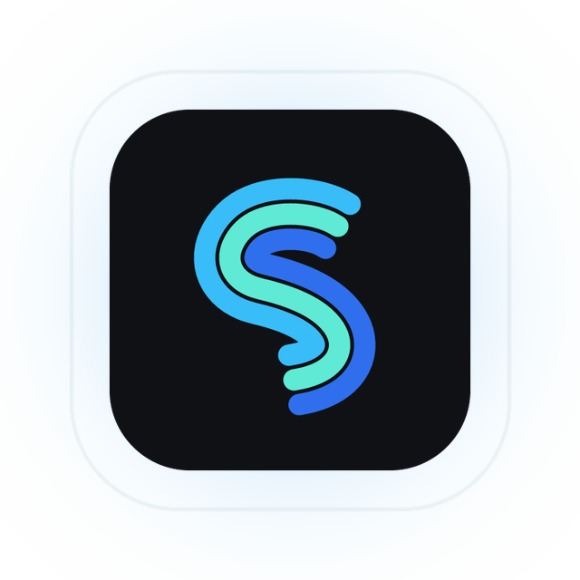
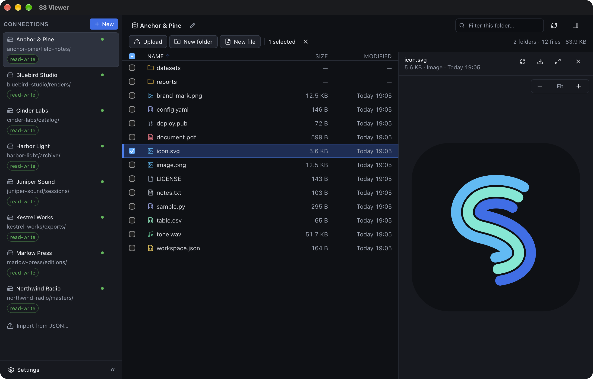

<p align="center">
  
</p>

<h1 align="center">S3 Viewer</h1>

<p align="center">
  <strong>Look inside your bucket before you download it.</strong>
</p>

<p align="center">
  An S3 browser that renders images, audio, video, PDFs, Markdown, source code,
  CSV and Parquet tables in place. Ranged reads mean a video starts playing on
  the first bytes, and your access keys never leave the machine in cleartext.
</p>

<p align="center">
  <a href="https://github.com/GregoryKogan/s3-viewer/releases/latest/download/S3-Viewer.dmg">
    
  </a>
  <a href="https://github.com/GregoryKogan/s3-viewer/releases/latest">
    
  </a>
</p>

<p align="center">
  <a href="https://github.com/GregoryKogan/s3-viewer/releases/latest">
    
  </a>
  
  <a href="LICENSE">
    
  </a>
  
</p>

<p align="center">
  <sub>macOS 14.2+ · Apple Silicon and Intel · about 12 MB · Linux <code>.deb</code> and AppImage in the same release</sub>
</p>

<p align="center">
  
</p>

<p align="center">
  <sub>The app's own icon, previewed from a bucket without downloading it.</sub>
</p>

<p align="center">
  <a href="#features">Features</a> ·
  <a href="#install">Install</a> ·
  <a href="#security">Security</a> ·
  <a href="#building">Build</a> ·
  <a href="#releasing">Releasing</a>
</p>

---

## Why another S3 browser?

Built for people whose buckets already work from `boto3` and who are tired of
clients that either cannot express their endpoint settings or drown them in
features for storage backends they will never use.

- **S3 only.** No FTP, no WebDAV, no SMB, no cloud-drive zoo.
- **boto3-shaped settings.** Every connection field maps one-to-one onto a
  `boto3.client("s3", ...)` or `Config(...)` argument, and the form shows the
  equivalent snippet as you type, so a working Python client can be transcribed
  by hand and will work.
- **Preview first.** Images, audio, video, PDFs, text, Markdown, JSON, CSV, code
  and Parquet render in a side panel instead of being downloaded just to be
  inspected.

## Features

**Everything you would otherwise download to check.** Most S3 tools show you a
file name and a size. This one shows you the file.

The full feature tour is on the
[landing page](https://gregorykogan.github.io/s3-viewer/).

## Browsing and operations

- **Finder-style list.** Breadcrumbs, sorting, filtering, multi-select, shift-click
  ranges, type-ahead and full keyboard control. A plain click moves the cursor and
  previews the row without selecting it; <kbd>⌘</kbd>/<kbd>Ctrl</kbd>-click selects,
  and a double click opens a folder or brings a hidden preview back. Checkboxes
  stay out of the way until you select something.
- **The breadcrumb is the connection root.** A connection pins one endpoint, one
  bucket and one prefix, so you cannot wander out of the prefix it was set up
  for. The address bar (<kbd>⌘L</kbd> or the pencil) accepts `s3://bucket/key`,
  `bucket/key` or a bare key; a bucket that is not this connection's is refused,
  and an address that does not exist says so instead of failing silently.
- **Transfers you can steer.** Upload files or a whole folder tree by button or
  drag and drop, download files or a folder with progress, create folder or file,
  delete folders recursively, copy and move — including between two saved
  connections. Downloads go to your Downloads folder under a non-colliding name;
  a folder becomes its own directory with its nested structure intact. The
  transfer panel offers Open and Reveal. A failed transfer can be retried or
  cancelled without leaving the app.
- **Copy and move without a round trip.** A server-side copy sends a selection to
  another folder or another saved connection. A file can travel between buckets
  without passing through your disk, and the same menu handles folders and single
  objects.
- **Context menu, not toolbar clutter.** Right-clicking a row offers
  Preview/Open, Download, Copy S3 URI, Copy name, Copy to…, Move to… and Delete.
  Right-clicking empty space offers Upload, New folder, New file and Refresh.
- **Safety switches, per connection.** Read-only mode, "ask before deleting",
  "ask before overwriting", and the permission probe itself. On a scratch bucket
  you can turn the confirmations off; on anything that matters you can leave them
  on.
- **Import what you already have.** Paste the JSON credentials file you already
  use, or a boto3 snippet straight out of your code, and the app creates the
  connections for you.
- **Several scopes, one bucket.** Saved connections are independent entries:
  point one at `team-a/releases/` and another at `team-b/releases/` and both are
  first-class places to work. Recently used connections float to the top.

## Preview support

Previews never download a whole file just to decide whether they can show it: the
app fetches at most 512 KB to classify the content, and media streams through a
custom `s3stream://` protocol that supports HTTP ranges, so playback starts before
the whole object arrives.

| Content | Behaviour |
| --- | --- |
| PNG, JPEG, GIF, WebP, BMP, ICO, AVIF, SVG | rendered inline |
| MP3, WAV, OGG, Opus, M4A, AAC, FLAC | player inline, seeking works |
| MP4, WebM, MOV, MKV | player inline, seeking works |
| PDF | embedded viewer with zoom, fit-to-width and page navigation, fetched with ranged reads |
| Markdown | rendered, with a **Rendered / Raw** switch |
| JSON, JSONL | pretty-printed and highlighted |
| CSV, TSV | parsed into a table (quotes and embedded newlines handled) |
| Parquet | schema, columns and the first rows as a table |
| code (Python, JS/TS, Rust, Go, Java, C/C++, YAML, TOML, SQL, shell, XML, CSS, …) | syntax highlighted |
| plain text | shown as-is, UTF-8 |
| everything else | refused with an explicit reason and a Download button |

> [!NOTE]
> The preview limit lives in Settings (25 MB by default; 2 MB to 1 GB). Files
> above it stay listed and downloadable, but the preview panel explains the limit
> instead of loading them. Audio and video are exempt: they stream over ranged
> reads, so even a multi-gigabyte file plays without being downloaded. Parquet has
> an additional 64 MB read ceiling.

Markdown is rendered through `marked` and then sanitised by a small allow-list
walker in `src/lib/previewText.ts`: unknown tags are unwrapped,
`script`/`iframe`/`object`/`embed`/`form` never survive, `on*` attributes are
dropped and `javascript:` URLs are stripped. There is an end-to-end check for
exactly this.

## Connections

Each saved connection pins one endpoint, one bucket and one prefix. The editor is
deliberately a thin skin over boto3:

| App field | boto3 |
| --- | --- |
| Endpoint URL | `endpoint_url=` |
| Region | `region_name=` |
| Access key ID | `aws_access_key_id=` |
| Secret access key | `aws_secret_access_key=` |
| Session token | `aws_session_token=` |
| Bucket | `Bucket=` (ListObjectsV2, PutObject, …) |
| Prefix | `Prefix=` |
| Addressing style | `Config(s3={"addressing_style": …})` |
| Signature version | `Config(signature_version=…)` |

### Addressing and signatures

- **Addressing style.** Many S3-compatible deployments require virtual-host
  addressing and answer path-style requests with `VirtualHostDomainRequired`. The
  default is `virtual`; switch to `path` for providers that demand the bucket in
  the URL path. The error itself carries a hint when this is the problem.
- **Signature version.** `s3v4` (the boto3 default) and `v4` use the AWS SDK for
  Rust. `s3v2`, the legacy HmacSHA1 scheme that some appliances still require, is
  implemented in this repository because the AWS SDK no longer speaks it — see
  `src-tauri/src/sigv2.rs`.
- **Permission probe.** On the first successful contact the app probes what your
  credentials may actually do — list, read, write, delete — and shows the result
  as a badge. The probe writes one uniquely named object and deletes it
  immediately; nothing of yours is touched. The write/delete part can be switched
  off per connection if your policy forbids even that.

## Security

- Secret access keys and session tokens are **never written to disk in
  cleartext**. Each is sealed with XChaCha20-Poly1305 under a random 32-byte
  master key.
- The master key lives in the OS keychain (macOS Keychain, Linux Secret Service).
  If no keychain is reachable it falls back to a `0600` file inside the config
  directory, and Settings says so explicitly rather than pretending otherwise.
- The config file is written `0600` inside a `0700` directory, atomically (write
  to a temporary file, then rename), and a corrupt file is backed up instead of
  being silently discarded.
- The app never logs secrets. `crypto::redact` exists so diagnostics can be shared
  safely.
- No telemetry. Apart from the launch-time update check against GitHub Releases,
  the only network traffic is to the S3 endpoint you configure.

Config location:

- macOS: `~/Library/Application Support/dev.s3viewer.app/config.json`
- Linux: `${XDG_CONFIG_HOME:-~/.config}/dev.s3viewer.app/config.json`

Override it with `S3VIEWER_CONFIG_DIR` (handy for tests).

## Install

Prebuilt releases are on the [landing page](https://gregorykogan.github.io/s3-viewer/)
or directly under [Releases](https://github.com/GregoryKogan/s3-viewer/releases/latest):

| Asset | Platform |
| --- | --- |
| [`S3-Viewer.dmg`](https://github.com/GregoryKogan/s3-viewer/releases/latest/download/S3-Viewer.dmg) | macOS 14.2+, universal (Apple Silicon and Intel) |
| [`S3-Viewer.AppImage`](https://github.com/GregoryKogan/s3-viewer/releases/latest/download/S3-Viewer.AppImage) | Linux, portable |
| [`S3-Viewer-amd64.deb`](https://github.com/GregoryKogan/s3-viewer/releases/latest/download/S3-Viewer-amd64.deb) | Linux, Debian/Ubuntu |
| [`SHA256SUMS.txt`](https://github.com/GregoryKogan/s3-viewer/releases/latest/download/SHA256SUMS.txt) | checksums for the three above |

On macOS, open the disk image, drag **S3 Viewer** into **Applications**, and add a
connection. On Linux the `.deb` installs through the package manager and the
AppImage just runs.

> [!WARNING]
> The macOS build is not notarised by Apple yet, so the first launch needs one
> allowance: **System Settings → Privacy & Security → Open Anyway**, or:
>
> ```bash
> xattr -dr com.apple.quarantine "/Applications/S3 Viewer.app"
> ```
>
> That prompt returns for each new version until the build is signed with a
> Developer ID. Release assets are named without a version on purpose, so
> `releases/latest/download/S3-Viewer.dmg` always points at the newest build.

### Auto-updates

Every launch asks GitHub Releases whether a newer version exists and, if it does,
offers to download and install it. On macOS the `.app` is replaced in place; on
Linux an AppImage updates itself, while a `.deb` install asks for the
administrator password and installs through `pkexec`. Both then restart into the
new version.

Bundles are signed with a minisign key baked into the app, so a tampered or
corrupted download is rejected instead of installed. The private key never lives
in the repo: CI reads it from the `TAURI_SIGNING_PRIVATE_KEY` secret, and a release
made without it fails on purpose. [`AGENTS.md`](AGENTS.md) spells out the whole
contract, including the version bump every release needs.

## Keyboard

The app is usable end to end without a pointer. `←`/`→` move between the
connections, the list and the preview; `Enter` opens; `Space` toggles the cursor
row; `Escape` clears the selection. On macOS use `⌘`, on Linux `Ctrl`.

| Action | Keys |
| --- | --- |
| Address bar | <kbd>⌘L</kbd> |
| Filter the folder | <kbd>⌘F</kbd> |
| Download the selection or the cursor row | <kbd>⌘D</kbd> |
| Copy S3 URIs | <kbd>⌘⇧C</kbd> |
| Upload files / a folder | <kbd>⌘U</kbd> / <kbd>⌘⇧U</kbd> |
| New connection / new folder | <kbd>⌘N</kbd> / <kbd>⌘⇧N</kbd> |
| Refresh the listing | <kbd>⌘R</kbd> |
| Open the row menu | <kbd>⇧F10</kbd> or right-click |

The full map — columns, focus restoration, dialogs, menus, the PDF viewer, and
what is deliberately left to the operating system — is in
[`docs/keyboard.md`](docs/keyboard.md).

## Building

Requirements: Rust (stable, 1.90+), Node.js with pnpm, and the platform toolchain.

```bash
pnpm install
pnpm build:frontend        # vite build → dist/
pnpm tauri dev             # run in development
CI=true pnpm tauri build   # package for the current platform
```

Outputs land in `src-tauri/target/release/bundle/`:

- macOS: `dmg/S3 Viewer_<version>_<arch>.dmg` and `macos/S3 Viewer.app`
- Linux: `deb/` and `appimage/`

`CI=true` matters for the `.dmg`: without it the bundler asks Finder to lay out
the disk-image window, which fails when the terminal lacks Automation permission
(`AppleEvent timed out`). The `.app` is produced either way.

The builds are unsigned. Local builds are unaffected by the updater:
`createUpdaterArtifacts` is passed by CI rather than set in `tauri.conf.json`,
precisely so that a build without a signing key still works. To sign properly,
add a Developer ID and notarisation to `src-tauri/tauri.conf.json`.

Linux packages are built by `.github/workflows/release.yml` on `ubuntu-22.04`,
which is the practical baseline for a `.deb` users can install.

## Testing

Three layers, all runnable locally:

```bash
cargo test --manifest-path src-tauri/Cargo.toml     # Rust: crypto, store, S3, SigV2, previews
pnpm test:js                                        # JS: formatting, CSV, boto3, versions, latest.json
node e2e/run.mjs                                    # real window, real bucket
```

`pnpm check` is the strict local gate: frontend build, `cargo fmt --check`,
`clippy -D warnings`, Rust tests. It does not run `pnpm test:js`, so run both
before tagging.

### The end-to-end suite

`tauri-driver` cannot drive the app on macOS: WKWebView ships no WebDriver
implementation, so it refuses to start. Rather than fake the window, the app hosts
the test itself — with `S3VIEWER_E2E=1` the real window boots, a scripted scenario
runs inside the real webview against the real Rust backend and a real bucket, and
the report is written to `$S3VIEWER_E2E_OUT`. Partial reports are published after
every check, so a hang names the check that hung.

`node e2e/run.mjs` seeds a disposable prefix, builds, launches, prints the report
and **always** deletes everything it created — including after a failure. A lock
file stops two concurrent runs from deleting each other's fixtures.

Credentials come from `~/.secrets/s3/s3-creds.json` or from `S3VIEWER_TEST_*`
environment variables. The suite is hard-wired to a single bucket (`e2e/creds.mjs`)
and refuses to run against anything else. See
[`docs/e2e-gui-testing.md`](docs/e2e-gui-testing.md) for the guardrails, how to
read a failure, and what the suite cannot test.

## Architecture

```
src/                       Vue 3 + Pinia webview
  App.vue                  shell: layout, keyboard, menus, dialogs
  components/
    layout/                sidebar, header, breadcrumb, toolbar, resizers, transfers
    browser/               virtualised object list and row
    preview/               panel and one renderer per media type
    dialogs/               connection editor, settings, import, copy/move, updates
    ui/                    buttons, badges, fields, modal frame, toasts
  stores/                  ui, connections, objects, progress, updates, toasts, dialogs
  lib/                     typed IPC bridge, formatting, key arithmetic, file kinds,
                           highlight.js setup, Markdown sanitiser, boto3 snippet
  composables/             dialogs, focus trap, object actions
  types/                   wire types mirroring the Rust Serialize shapes

src-tauri/src/
  lib.rs                   Tauri builder and the s3stream:// range protocol
  commands.rs              the Tauri command surface
  state.rs                 shared AppCore
  s3/aws.rs                ObjectStore over the AWS SDK (SigV4)
  s3/v2.rs                 ObjectStore for the legacy SigV2 scheme
  sigv2.rs                 the V2 canonical string and HmacSHA1 signature
  preview.rs               the preview policy: what is shown, and why not
  parquet_preview.rs       Parquet schema and rows
  objects.rs               listing, transfer and key arithmetic
  store.rs, crypto.rs      connections and sealed secrets
  progress.rs              transfer progress
  e2e/                     the self-hosted end-to-end harness
```

Two rules worth knowing before editing:

- **A listing is swapped in only when it finishes.** Pages arrive as events and
  accumulate off-screen; the visible list changes once, so a cancelled load can
  never be mistaken for an empty folder.
- **Geometry is applied to the document, not through template branches.** The
  panel widths and the sidebar's collapsed state are CSS custom properties and
  attributes on the root element. That is what the shell is laid out from, so the
  DOM cannot drift from the store.

The `ObjectStore` trait has two implementations, selected by the connection's
signature version. Because `async fn` in traits is not dyn-compatible, dispatch
goes through a small `AnyStore` enum rather than trait objects.

## Releasing

A release is a tag push. CI checks that the tag matches `tauri.conf.json`, builds
both platforms, signs the `.app`, the AppImage and the `.deb`, writes
`latest.json`, and publishes the GitHub Release. Nothing else is needed — the app
picks the release up on its next launch.

```bash
# Bump the same version in all three files:
#   src-tauri/tauri.conf.json
#   src-tauri/Cargo.toml
#   package.json
git commit -am "chore(release): 0.2.0"
git tag v0.2.0
git push origin main v0.2.0
```

The tag must be exactly `v` plus that version. `pnpm test:js` asserts the three
files agree, and CI fails if the tag disagrees, because an installed copy would
otherwise install the "new" version and then be offered it again on every launch.
Use semver; `v0.2.0` inside the config is not valid semver and breaks the
comparison.

The signing key is a repository secret: **Settings → Secrets and variables →
Actions → `TAURI_SIGNING_PRIVATE_KEY`**, holding the single-line content of
`~/.tauri/s3-viewer.key`. It is never committed, and losing it means no installed
copy can be updated again. The public half is `plugins.updater.pubkey` in
`src-tauri/tauri.conf.json`; changing it orphans every user.

`latest.json` lists every platform with the signature of its bundle; the app
fetches it through `releases/latest/download/latest.json`. Drafts and prereleases
are invisible to the updater. The full release checklist, the four platform keys,
the asset-name invariants and the verification steps live in
[`AGENTS.md`](AGENTS.md).

## Contributing

Issues and pull requests are welcome. Before changing the updater, signing, or the
release workflow, read [`AGENTS.md`](AGENTS.md) — it documents the invariants that
keep installed copies updatable.

## License

MIT © Gregory Koganovsky. See [`LICENSE`](LICENSE).

---

<p align="center">
  <sub>Built with Tauri, Vue 3 and Rust. The landing page lives in <a href="site/">site/</a>.</sub>
</p>
